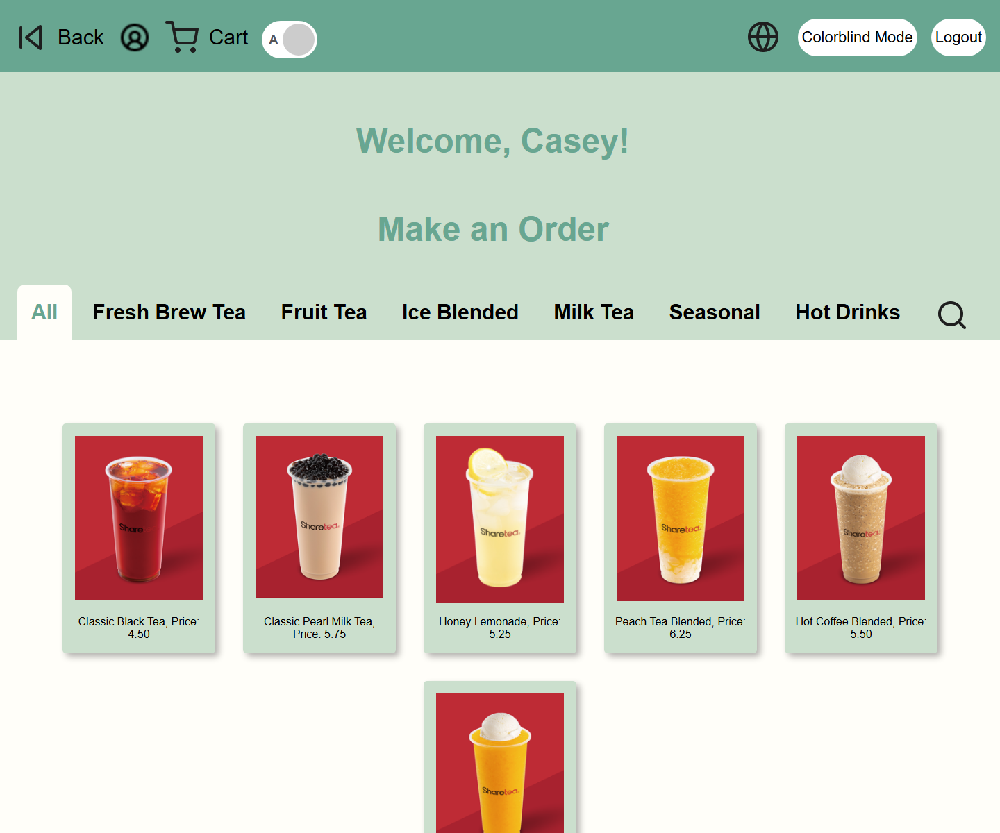
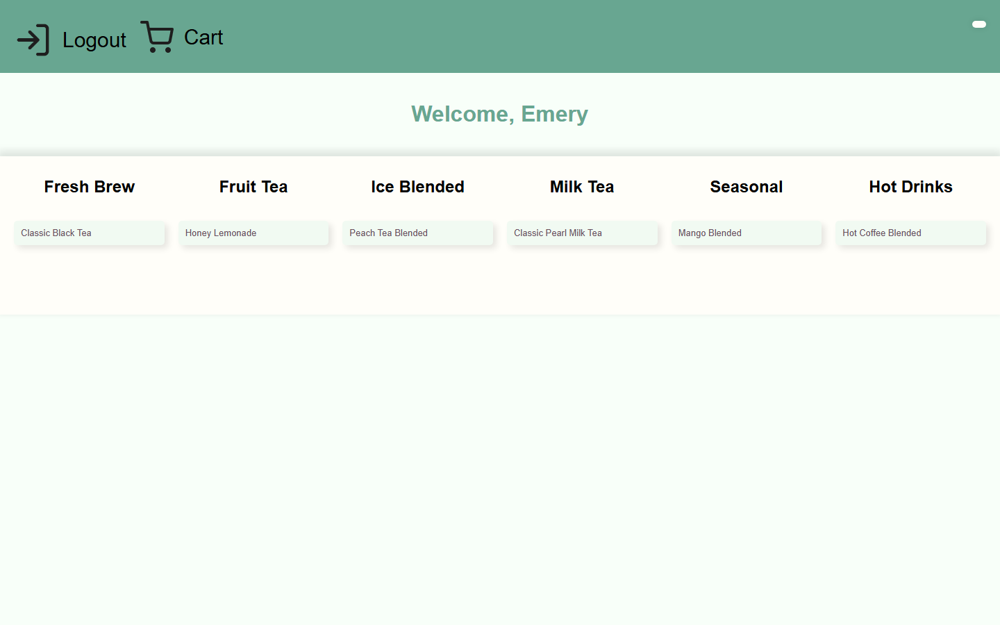
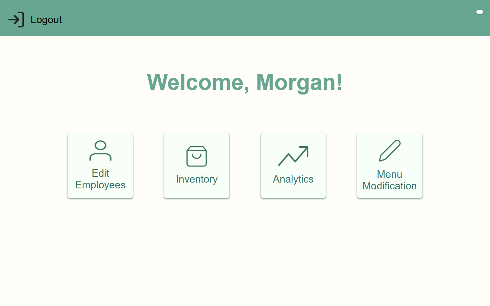

# HTeaML Boba Customer Kiosk

An accessible self-service ordering kiosk for a boba shop. The project is designed to help customers place orders independently, including customers with color-vision differences, low vision, or blindness.

## Highlights

- Customer, employee, and manager flows
- Google OAuth sign-in with role-based access
- PostgreSQL-backed menu and order data
- Weather information on kiosk pages via OpenWeather
- Audio-ordering experiment using OpenAI transcription and structured order parsing

## Tech stack

Node.js, Express, EJS, PostgreSQL, Google OAuth, OpenWeather, and OpenAI APIs.

## Try the local demo

The demo runs with fictional menu, inventory, order, customer, and staff data. It uses [PGlite](https://pglite.dev/docs/), an in-memory PostgreSQL engine, so it needs **Node.js 20+ only**: no database server, OAuth credentials, or API keys. The sample data resets each time the server restarts.

```bash
npm install
npm run demo
```

Open <http://127.0.0.1:3000> and choose **Customer Kiosk**, **Cashier**, or **Manager**. The demo account for each role is created in your local browser session. The demo binds to `127.0.0.1` and is disabled when `NODE_ENV=production`.

Suggested walkthrough:

1. Choose **Customer Kiosk**, select a drink, set its options, add it to the cart, and confirm the order.
2. Return to the home page and choose **Cashier** to browse the same seeded menu.
3. Return to the home page and choose **Manager** to view inventory, menu editing, and analytics with sample orders.

Weather is omitted when no OpenWeather key is configured. Voice ordering needs an OpenAI key and is outside the no-key demo path. The included audio recordings are demo artifacts; `example.mjs` is an independent OpenAI proof of concept.

### Screenshots from the local demo





## Run with your own PostgreSQL database

For a local PostgreSQL setup, create an empty database and load [db/sample.sql](db/sample.sql). All names and emails in that file are fictional; use your own data and credentials for any real deployment.

```bash
createdb hteaml_demo
psql -d hteaml_demo -f db/sample.sql
cp .env.example .env
```

On Windows PowerShell, use `Copy-Item .env.example .env` for the last command. Fill in the PostgreSQL settings in `.env`; set `PSQL_SSL=true` only if your database requires SSL. The regular server also needs Google OAuth credentials for role sign-in.

```bash
npm start
```

Open <http://localhost:3000>. The demo accounts and `/demo/:role` routes are available only with `npm run demo`.

## Project structure

```text
.
├── index.js           # Express server entry point
├── db/                # Database connection and fictional demo seed
├── demo.js            # Starts the local-only demo
├── docs/screenshots/  # Screenshots captured from the running demo
├── routes/             # Customer, employee, manager, and API routes
├── views/              # EJS templates
├── public/             # Browser JavaScript, styles, images, and audio
├── services/           # Voice-ordering helpers
├── example.mjs        # Voice-ordering proof of concept
├── .env.example       # Required environment variables (safe to commit)
├── package.json
└── *.m4a              # Demo recordings
```

## Contributing

Keep credentials in `.env` only. Before opening a pull request, run:

```bash
npm test
```

